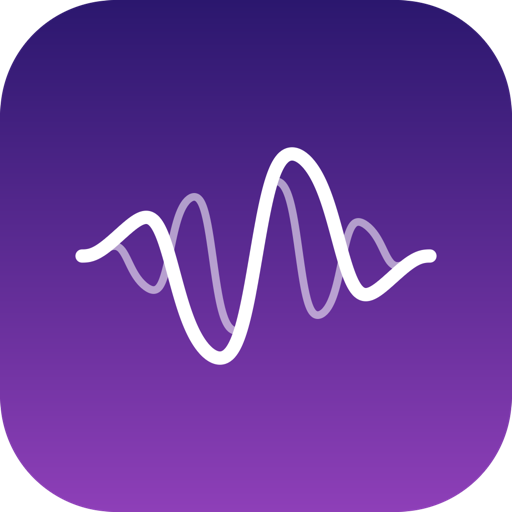
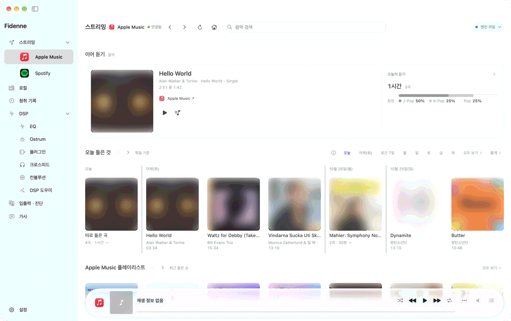

<!-- SPDX-FileCopyrightText: 2026 The Aural Authors -->
<!-- SPDX-License-Identifier: LicenseRef-Fidenne-Freeware -->
<!-- Translated from tools/release/public-root/README.md at commit 5fe772e9baf1fbd1be25fefcf85283d74d6a03f9 -->

<p align="center">
  
</p>

<h1 align="center">Fidenne</h1>

<p align="center">
  A Mac app that refines the sound of the music app you already use with DSP and sends it to your external DAC
</p>

<p align="center">
  <b>Public beta 1 · 0.6.0 — <a href="https://github.com/fidenne/fidenne/releases/latest">Download</a> · <a href="https://fidenne.github.io/fidenne/">Install and use guide (Korean)</a></b>
</p>

<br>

<p align="center">
  
</p>

<br>

## What it is

Fidenne is a Mac app that refines the sound of the music app you already use with DSP and sends it to your external DAC.
Keep using Apple Music, Spotify, YouTube Music or the app you know, and choose DSP and an output mode suited to your DAC in Fidenne.
The music still plays in each service's own app, so play counts and ads stay with the service; Fidenne never blocks or skips ads.

<br>

## The path your sound takes

```
Player  →  Fidenne (EQ · Ostrum · Crossfeed · output conversion)  →  your DAC
Player  →  macOS  →  your DAC                                        (PCM Direct)
```

PCM Direct means Fidenne does not process the sound; it goes through macOS straight to the DAC.
The Playback Chain in the app shows at a glance which path is in use.

<br>

## What you can do

- Choose the output mode that suits your DAC — DSD (DoP) · PCM 352.8 kHz · PCM Direct.
- Change EQ, Ostrum, Crossfeed and filters and hear the result right away.
- Check the path your sound takes and the processing in use in Playback Chain.
- Control the service app you already use from Fidenne and view track information and lyrics alongside it (playback stays in each service’s own app).
- Sound is never recorded.

<br>

## What's new in 0.6.0

- The home and streaming screens are new, and Apple Music, Spotify and YouTube Music look the same. Continue listening, today's listening, your playlists and saved albums are on one screen.
- Drag songs to set their order in a playlist or album, and save an album to the service's library from the app.
- Translate lyrics with your own API key (Anthropic Claude · OpenAI · Google Gemini) or with the Apple model on this Mac. The Lyrics tab gathers the lyrics and translations of the songs you have heard.
- YouTube Music also works in Safari. The extension is inside the app, so there is no file to install.
- It opens on macOS 15 (up to 0.5.2 it needed macOS 26).
- When a song moves on by itself, the DAC rate is not touched. If the app fails to start repeatedly, a recovery screen opens it without erasing your settings.
- The app checks for a new version every 4 hours, and downloads one only when you choose to install it in the update window; it installs after checking the signature.

The full list of changes is on the [releases page](https://github.com/fidenne/fidenne/releases/latest).

<br>

## What you need

- A Mac with Apple silicon (M1 or later) and **macOS 15 or later**. It does not open on an Intel Mac.
- A **wired external DAC connected directly by USB**. DSP (EQ · Ostrum · Crossfeed) and DSD · PCM 352.8 kHz output run on a **2-channel DAC that accepts 352.8 kHz**. Devices that do not, such as built-in speakers, AirPods, most dongles and monitors, can only be listened to in **PCM Direct** (Fidenne does not process the sound; it goes through macOS).
- The app is free.

<br>

## Installation

This is 0.6.0 of public beta 1. Install it like this.

1. Download the `.dmg` file from the [releases page](https://github.com/fidenne/fidenne/releases/latest) of this repository.
2. Open the `.dmg` and drag Fidenne into the **Applications** folder. Do not run it straight from the disk image or the Downloads folder (the Safari extension would not show).
3. Open Fidenne from Applications and press **Open** if a confirmation window appears.
4. Follow the first-run setup. Allow the permissions macOS asks for.

Before the first playback, turn down the volume on your DAC and amplifier. Step-by-step instructions are in the [install and use guide](/docs/user/GUIDE.md) (Korean only) and the [User manual](/docs/user/en/MANUAL.md).

<br>

## What Fidenne uses

A free app made by an individual, not affiliated with Apple, Spotify or Google.

- **Apple Music · Spotify** — Fidenne controls each app for you. Spotify's search and playlist screens work only with a Spotify Premium account and a Spotify developer key you create yourself, and that is optional. Every Spotify item there opens in Spotify through **OPEN SPOTIFY**. Without connecting, Fidenne still processes the sound of the Spotify app.
- **YouTube Music** — an experimental feature connected through a browser extension. It reads only the track on the page you opened and never touches ads. What it reads goes only to Fidenne on this Mac and nowhere else.
- **Lyrics · headphone measurements · song search and charts** — public data from LRCLIB, squig.link and Apple, fetched to this Mac. Copyright stays with the rights holders and the measurers.
- **Sound** — processed only on this Mac. Never recorded or sent anywhere.
- **Album covers and lyrics** — kept on this Mac temporarily for quick display and removed 30 days after last use. Pictures from song search and charts stay in memory only.

The full list is in the [Privacy notice](/PRIVACY.en.md).

<br>

## Help

- [Install and use guide](/docs/user/GUIDE.md) (Korean only) — from installing to everyday use, in order.
- [User manual](/docs/user/en/MANUAL.md) · [Troubleshooting guide](/docs/user/en/TROUBLESHOOTING.md) · [Known limitations](/docs/user/en/KNOWN_LIMITATIONS.md)
- Contact: fidenne.support@gmail.com
- Rights and terms enquiries: fidenne.support+legal@gmail.com

## FAQ

**Is the source code public?**
No. Fidenne is a personal project, and the app's source code is not published. The app stays free.

**Is there an SDK for building extensions?**
One is planned, but it is not confirmed and there is no date yet. The licence under consideration is Apache-2.0. Details will follow when it is published.

## Issues

Bugs and suggestions are received as issues in this repository. For anything hard to write as an issue, use email: **fidenne.support@gmail.com**.
Please do not write security problems in a public issue; report them by the method in `SECURITY.en.md`.

When you report, attach the support file made by **Help > Create diagnostics for a problem report...** in the app (it shows its content before anything is sent) to a mail and write one line on what happened. Do not post the support file in an issue.
**Send by mail** opens your mail app; with another mail service, **Copy mail form** gives the address, subject and form to paste. The app version and macOS version are already in the form and the support file. The app sends nothing on its own.

<br>

<sub>Apple Music is a trademark of Apple Inc., Spotify of Spotify AB and YouTube Music of Google LLC. Fidenne is not affiliated with these companies.</sub>

<sub>Used under free-to-use terms — see `LICENSE`. Third-party components in the app are listed in the `THIRD_PARTY_NOTICES.md`.</sub>
