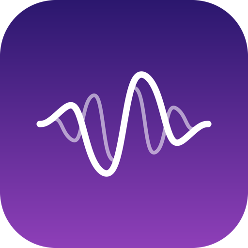
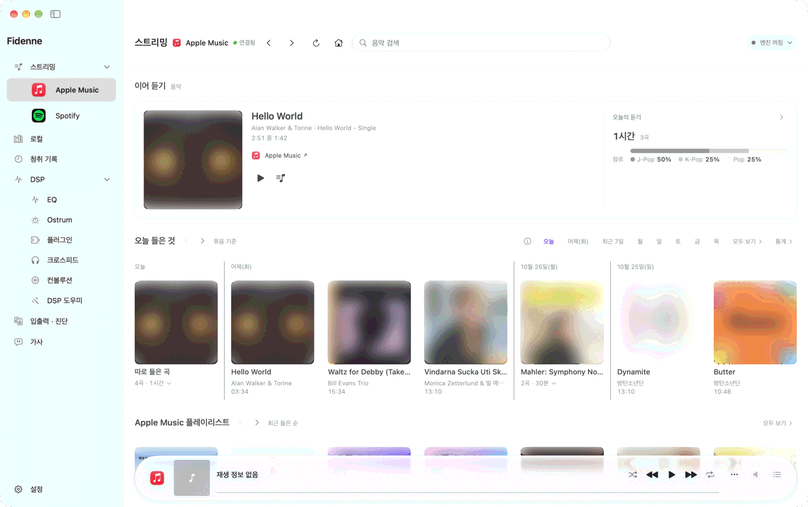

<!-- SPDX-FileCopyrightText: 2026 The Aural Authors -->
<!-- SPDX-License-Identifier: LicenseRef-Fidenne-Freeware -->
<!-- Translated from tools/release/public-root/README.md -->

<p align="center">
  
</p>

<h1 align="center">Fidenne</h1>

<p align="center"><a href="README.md">한국어</a> | <a href="README.en.md">English</a> | 日本語</p>

<p align="center">
  再生中のアプリの音を DSP で整えて外付け DAC に送る Mac アプリ
</p>

<p align="center">
  <b>パブリックベータ 1 · 0.8.0 — <a href="https://github.com/fidenne/fidenne/releases/latest">ダウンロード</a> · <a href="https://fidenne.github.io/fidenne/ja/">インストール・使い方ガイド</a></b>
</p>

<br>

<p align="center">
  
</p>

<br>

## どんなアプリですか

Fidenne は、再生中のアプリの音を DSP で整えて外付け DAC に送る Mac アプリです。
Apple Music · Spotify · YouTube Music など普段使っているアプリはそのまま使い、Fidenne で DSP と DAC に合った出力方式を選びます。
音楽は各サービスのアプリでそのまま再生されるため、再生回数のカウントや広告は各サービスの仕様通りであり、Fidenne が広告をブロックしたりスキップしたりすることはありません。

<br>

## 音が通る経路

```
再生アプリ  →  Fidenne (EQ · Ostrum · クロスフィード · 出力変換)  →  自分の DAC
再生アプリ  →  macOS  →  自分の DAC                                    (PCM Direct)
```

PCM Direct は、Fidenne が音を処理せず macOS を経由して直接 DAC に送る方式です。
現在どの経路を通っているかは、アプリの Playback Chain で一目で確認できます。

<br>

## できること

- 出力方式を DAC に合わせて選びます — DSD(DoP) · PCM オーバーサンプリング(44.1 ~ 768 kHz) · PCM Direct。
- EQ · Ostrum · クロスフィードやフィルターを切り替えながら、すぐに聴き比べられます。
- 音が通る経路と適用中の処理を Playback Chain で確認します。
- 普段使っているサービスアプリを Fidenne から操作し、曲情報や歌詞を一緒に表示します（再生は各サービスアプリが行います）。
- 音の録音は行いません。

<br>

## 0.8.0 での変更点

**音**
- ローカルの 5.1 · 7.1 · 7.1.4 ファイルをマルチチャンネル出力デバイスへ無処理のまま送ります。再生ピルに **マルチチャンネルそのまま** と表示されます。
- **プラグイン** ページの **マルチチャンネル入力プラグイン** を使って、5.1 · 7.1 ファイルを空間オーディオ Audio Unit に通し、ヘッドホン用の 2 チャンネルまたは元のチャンネル構成で聴けます。
- EQ バンドを最大 256 個まで設定できます。
- **入出力 · 診断 › 詳細 › PCM** で、DAC ごとに 44.1 · 48 kHz 系列の最大レートを下げて不安定なレートを回避できます。
- 曲が再開される際、無音のまま過ぎ去っていた冒頭部分を巻き戻して最初から聴こえるようにし、ファイル末尾の最後の音まで DAC にすべて届きます。

**画面とツール**
- 大きな再生画面（アルバムモード）が **再生中 · 動画 · 情報** の 3 ページに分かれました。情報ページではアルバム · ジャンル · 音質 · 参加者を、動画ページではリンク · ファイル · 検索で見つけた動画を音楽の再生位置に合わせて表示します。
- ストリーミングのホーム画面にサービス別のセクション（Apple Music おすすめ · チャート · 最近の再生、Spotify 最近の再生 · よく聴く曲 · 保存したアルバム）が追加され、Spotify · ローカル検索では **もっと見る** から続きを見られます。
- 他のアプリを使っている間に現在の行と次の行を小さなウィンドウで表示する **フローティング歌詞**（⇧⌘L）と、日本語の漢字の上にかなで読みを振る **読みの表示** が追加されました。
- Fidenne のリストは末尾から先頭へループし、YouTube Music は曲を最後まで聴いてから次の曲へ進みます。

変更点の全体は[リリースページ](https://github.com/fidenne/fidenne/releases/latest)にあります。

<br>

## 必要な環境

- Apple シリコン（M1 以降）の Mac と **macOS 15 以上**。Intel Mac では起動しません。
- **外付け DAC の使用をおすすめします。** USB で直接接続した有線 DAC は、Fidenne がデバイスを直接制御して音を処理・送信します。DSP（EQ · Ostrum · クロスフィード）と DSD · PCM 出力は、**エンジンが使用する PCM レート（44.1 ~ 768 kHz）のうち 1 つ以上に対応する 2 チャンネル DAC** で動作します。DSD は DoP をデコードできる DAC でのみ使用できます。
- 内蔵スピーカー · 3.5 mm 端子 · AirPods · HDMI にも Fidenne で処理した音を送れます。これらのデバイスでは macOS が最後にミキシングして出力するため、画面に「システムミキサー経由 · ビットパーフェクトではありません」と表示されます。4 · 8 チャンネルのオーディオインターフェースのように 2 チャンネルではないデバイスや、44.1 ~ 768 kHz のレートに 1 つも対応していないデバイスは、Fidenne の処理を通さず **PCM Direct** で再生します。
- アプリは無料です。

<br>

## インストール

パブリックベータ 1 の 0.8.0 です。次の手順でインストールします。

1. このリポジトリの[リリースページ](https://github.com/fidenne/fidenne/releases/latest)から `.dmg` ファイルをダウンロードします。
2. `.dmg` を開き、Fidenne を **アプリケーション** フォルダにドラッグ＆ドロップします。ディスクイメージ内やダウンロードフォルダから直接開かないでください（Safari 機能拡張が表示されません）。
3. アプリケーションから Fidenne を開き、確認ダイアログが表示されたら **開く** をクリックします。
4. 初回設定ウィンドウの案内に従います。macOS がアクセス権を求めた場合は許可してください。

初めて再生する前に、DAC とアンプの音量を下げておいてください。手順ごとの説明は[インストール・使い方ガイド](/docs/user/ja/GUIDE.md)にあります。

<br>

## Fidenne が使用するもの

Apple · Spotify · Google とは関係のない個人が制作した無料アプリです。

- **Apple Music · Spotify** — 各アプリを Fidenne が代わりに操作します。Spotify の検索 · プレイリスト画面は Premium アカウントとユーザーが自分で作成した Spotify 開発者キーがある場合のみ使用する任意機能です。この画面の Spotify 項目はすべて **OPEN SPOTIFY** から Spotify で開けます。連携しなくても Spotify アプリの音はそのまま処理されます。
- **YouTube Music** — ブラウザ機能拡張で連携する実験的機能です。ユーザーが開いたページの曲情報のみを読み取り、広告には関与しません。読み取った情報はこの Mac の Fidenne にのみ渡され、外部には送信されません。
- **歌詞 · ヘッドホン測定データ · 曲検索とチャート** — LRCLIB、squig.link、Apple の公開データをこの Mac に取得して使用します。著作権は各権利者および測定者に帰属します。
- **音声** — この Mac の内部でのみ処理されます。録音したり外部へ送信したりすることはありません。
- **アルバムアートワークと歌詞** — 通常のアートワークと歌詞の検索キャッシュは、最後に使用してから 30 日後に削除されます。Spotify のアートワークは取得日から 30 日間保持され、歌詞タブに保存した歌詞と翻訳は自分で削除するまで残ります。曲検索 · チャートの画像はメモリ上にのみ保持されます。

全体の一覧は[プライバシーポリシー](/PRIVACY.ja.md)にあります。

**ブラウザ機能拡張における情報の利用（限定的使用）** — Safari · Chrome · Edge の Fidenne 機能拡張が受け取る情報は、現在再生中の曲をこの Mac の Fidenne に通知し、ユーザーが押した操作コマンドを YouTube Music の画面へ伝える目的にのみ使用されます。販売したり、広告に使用したり、第三者に提供したりすることはありません。Safari 機能拡張は Fidenne アプリ内に同梱されており、Chrome 機能拡張による情報の取り扱いは Chrome ウェブストアのユーザーデータポリシー（限定的使用の要件を含む）に準拠しています。

<br>

## ヘルプ

- [インストール・使い方ガイド](/docs/user/ja/GUIDE.md) — インストールから使い方まで順番に解説。
- [取扱説明書](/docs/user/ja/MANUAL.md) · [トラブルシューティングガイド](/docs/user/ja/TROUBLESHOOTING.md) · [既知の制限事項](/docs/user/ja/KNOWN_LIMITATIONS.md)
- お問い合わせ: fidenne.support@gmail.com
- 権利・規約に関するお問い合わせ: fidenne.support+legal@gmail.com

## よくある質問

**ソースコードは公開されますか？**
いいえ。Fidenne は個人プロジェクトとして開発しており、アプリのソースコードは非公開です。アプリは引き続き無料で配布します。

**拡張機能を作成できる SDK はありますか？**
サポートを計画していますが確定しておらず、時期も未定です。ライセンスは現在 Apache-2.0 を検討しています。詳細は公開時にお知らせします。

## イシュー

バグ報告やご提案はこのリポジトリの Issues で受け付けています。Issue に書きにくい内容はメール **fidenne.support@gmail.com** までお送りください。
セキュリティに関する問題は公開 Issue には書かず、`SECURITY.ja.md` に記載された方法でお知らせください。

ご報告の際は、アプリの **ヘルプ → 問題報告用の診断を作成…** で作成したサポートファイル（送信前に内容を確認できます）をメールに添付し、何が起きたかを 1 行だけ添えてください。サポートファイルは Issue にはアップロードしないでください。
**メールで送る** をクリックするとメールアプリが開き、別のメールクライアントを使う場合は **メールのひな形をコピー** で宛先 · 件名 · ひな形を貼り付けられます。アプリのバージョンと macOS のバージョンはひな形とサポートファイルに自動で含まれます。アプリがユーザーの代わりに何かを自動送信することはありません。

<br>

<sub>Apple Music は Apple Inc.、Spotify は Spotify AB、YouTube Music は Google LLC の商標です。Fidenne はこれらの企業とは関係がなく、推奨や保証を受けたものではありません。</sub>

<sub>無料で利用できる規約に従います — `LICENSE`。アプリに含まれるサードパーティ製コンポーネントは `THIRD_PARTY_NOTICES.md` に記載されています。</sub>
