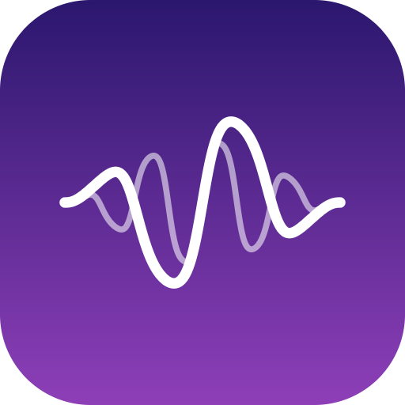

  

<h1 align="center">Fidenne</h1>

macOS를 위한 실시간 오디오 프로세싱 앱

<strong>베타 준비 중 · Coming soon</strong>

## 어떤 앱인가요?

Mac에서 Apple Music·Spotify·YouTube Music에 EQ와 DSD 변환을 제대로 걸고, 세 서비스를 macOS 네이티브 화면으로 쓰려고
만든 앱입니다. 원래 쓰던 앱으로 재생하면 그 소리를 받아 처리한 뒤 DAC로 보냅니다.

무료이고 광고가 없습니다. 앱을 유료로 바꿀 계획은 없습니다. 소스 코드는 공개하지 않으며, 확장용 SDK(C ABI)를 검토하고 있습니다.

## 주요 기능

- **3사 스트리밍 + 로컬 보관함** — Apple Music, Spotify, YouTube Music과 Mac의 음악 파일을 재생합니다. 서비스마다 홈·재생목록·검색·가사가 따로 있고, 청취 기록과 통계만 한곳에 모아 봅니다.
- **곡마다 원본 샘플 레이트에 맞춤** — 곡 중간에 끊지 않고 곡 사이에서만 바뀝니다. Apple Music에서 스트리밍으로 처음 트는 곡은 macOS 변환이 걸릴 수 있습니다.
- **PCM · PCM 오버샘플 · DSD 변환** — 오버샘플은 베타에서 352.8 kHz만 지원합니다. DSD는 DoP로 DSD256까지입니다. 업샘플링 필터를 고를 수 있습니다(352.8 kHz 이상을 받는 DAC를 권장하며, 그 밖의 장치는 베타에서 제한적입니다).
- **DAC 독점 사용** — 다른 앱이 DAC에 끼어들지 못합니다.
- **EQ** — 32밴드 파라메트릭 EQ와 Auto EQ(헤드폰 측정을 검색해 타깃 곡선에 자동으로 맞춤).
- **Ostrum** — 저음 무게, 중고역 존재감, 스테레오 폭, 배음을 다듬는 톤 셰이퍼.
- **크로스피드**
- **스트리밍 연동 없이도 사용** — 재생은 각 앱에서 직접 하고, Mac 출력을 **Fidenne Inlet**(앱이 설치하는 가상 입력)으로 두면 브라우저든 게임이든 나오는 소리를 처리합니다. BlackHole 같은 다른 가상 장치도 잡히지만 지금은 Fidenne Inlet을 권장합니다. 아직 스테레오 입력·스테레오 출력만 지원합니다.

## 하지 않는 것

- 녹음, 저장, 다운로드를 하지 않습니다. 소리는 메모리에서만 지나갑니다.
- DRM을 건드리지 않습니다. 공식 앱과 본인 계정으로 튼 소리만 받습니다.
- 청취 기록과 통계는 내 Mac에만 쌓이고 개발자에게 오지 않습니다. 나중에 익명 통계 보내기를 넣게 되면 기본은 꺼져 있고 미리 공지합니다.
- 밖으로 나가는 통신은 목적지별로 모두 공개하며, 대부분 설정에서 끌 수 있습니다.

## 서비스 약관을 지키는 방식

**Apple Music** — 재생은 Apple의 Music 앱이 합니다. Fidenne은 Music을 대신하지 않고 Mac에서 나오는 소리를 처리할 뿐입니다. 지금 곡 정보는 AppleScript로, 보관함은 Apple 공식 MusicKit으로 읽습니다. 재생 제어를 위해 Music 보관함에 대기열용 재생목록 하나("Fidenne 재생 대기열")를 만듭니다.

**Spotify** — 앱에 제 키를 넣지 않습니다. 사용자 본인의 개발자 키(Client ID)로 연결하며 Spotify 개발자 약관에도 본인이 동의합니다. 키 없이도 Spotify 앱에서 튼 소리는 처리됩니다. 키는 앱 안에서 목록을 보고 조작할 때만 필요합니다. 다른 서비스 결과와 섞는 통합 검색에는 Spotify 결과를 넣지 않고, Spotify API로 받은 정보는 다른 서비스로 보내거나 곡 연결·청취 통계에 쓰지 않습니다.

**YouTube Music** — 본인 브라우저(Chrome·Edge)에서 본인 계정으로 재생합니다. 확장은 페이지에 보이는 곡 정보만 읽어 앱에 알리며, 페이지나 광고를 고치지 않습니다. 베타 동안은 개발자 모드로 설치하고, 정식 때 스토어 심사를 받을 예정입니다.

서비스 로고는 각 회사가 허락한 방식으로만 씁니다. 헤드폰 보정은 AutoEq(MIT), 업데이트는 Sparkle(MIT)을 사용하며, 라이선스 전문은 베타 배포 때 앱 안과 이곳에 함께 올립니다.

## 공개 안내

Apple Silicon Mac, **macOS 27 이상**을 지원합니다(테스트는 M4 맥북에서 하고 있습니다). 더 아래 버전은 확인한 뒤 지원 여부를 정합니다.

이 저장소가 Fidenne의 소개와 공지, 그리고 배포 페이지입니다. 아직 내려받을 수 있는 배포본은 없고, 베타가 열리면 이 저장소의 **Releases**에 올립니다. 진단·오류 제보 방법(현재는 자동 전송이 없고 로그 파일을 보내 주셔야 합니다)과 베타 이용 동의 등은 배포 때 안내합니다.

## 첫 베타 직후 넣을 것

- 소스 하나만 받기(고른 앱 소리만 받고 나머지는 조용히)
- 필터 샘플 레이트 추종 모드 토글
- 모든 모듈레이터에 디더 토글
- Spotify 대기열·반복 맞추기, YouTube Music 검색 넓히기, 곡 목록 열을 눌러 정렬
- 자잘한 화면 정리

## 더 나중에 (순서와 시기는 미정)

**소리** — PCM 업샘플 레이트 넓히기(176.4·88.2 kHz부터, 이후 705.6 kHz와 384·768 kHz) · 끊김 없음 모드(입력을 한 레이트로 고정해 전환 자체를 없앰, 측정 뒤 결정) · 홈 시어터 HDMI 멀티채널과 Atmos(조사 중, 정식 뒤)
**서비스** — 브라우저 재생도 곡 원본 레이트로 받기
**듣기 편의** — AI 가사 번역(지금의 macOS 번역 엔진 대신 AI 서비스를 고를 수 있게 함 — 본인 API 키로, LRCLIB에서 받은 가사에만, 번역은 사용자 본인 화면에서만 보이고 저장·공유하지 않음, 기본 꺼짐) · 싱크 없는 가사를 직접 맞추기 · 미니 바 모드 · 재생 주도권 고르기 · 리모컨(iPhone·iPad·Apple Watch)
**그 밖에** — 영어 UI · YouTube Music 확장의 크롬 웹 스토어 등록

## 후원

앱은 계속 무료입니다. 정식 릴리스 이후 상황을 보아 개발자 라이선스와 유지보수 비용을 충당할 목적으로 자율 후원 링크(Buy Me a Coffee 또는 GitHub Sponsors)를 **이 페이지에만** 작게 둘 수 있습니다. 앱 안에는 넣지 않습니다.

## 면책과 고지

- Fidenne은 Apple, Spotify, Google·YouTube와 관계가 없는 **비공식 앱**입니다. 각 서비스의 이름과 로고, 상표는 해당 회사의 것입니다.
- 앱은 "있는 그대로" 제공되며, 사용으로 생기는 문제에 대한 책임은 [사용 약관](LICENSE)에 정한 범위로 제한됩니다.
- 음악, 가사, 번역, 그 밖의 제3자 콘텐츠에 대한 권리는 각 권리자에게 있으며 Fidenne은 그에 대한 사용 허가를 주지 않습니다.
- 각 서비스의 약관, 저작권법, 해당 지역의 법을 지키는 것은 사용자 본인의 몫입니다. Fidenne은 사용자가 본인 계정으로 정당하게 재생하는 소리만 처리하도록 만들었습니다.

## 의견 주세요

쓰시는 DAC·헤드폰, 끊김, 레이트가 안 맞는 곡, 헷갈리는 화면을 알려 주시면 큰 도움이 됩니다. 쓴소리도 환영합니다.

---

**Fidenne** is a free, ad-free real-time audio processing app for macOS: EQ and headphone correction, DSD/PCM output, per-track sample-rate matching, and a native macOS front-end for Apple Music, Spotify and YouTube Music. An open beta is being prepared; downloads are not yet available. The source code is not public.

보안 문제는 [비공개 제보 안내](SECURITY.md)를 확인해 주세요.
