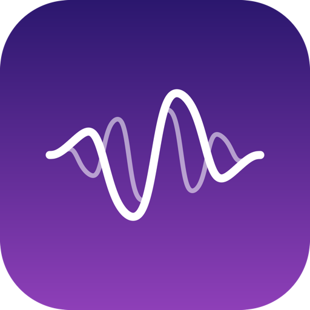
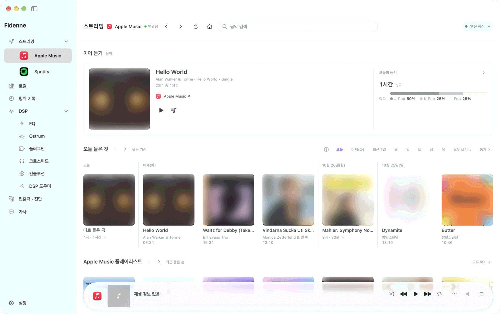

<!-- SPDX-FileCopyrightText: 2026 The Aural Authors -->
<!-- SPDX-License-Identifier: LicenseRef-Fidenne-Freeware -->

<p align="center">
  
</p>

<h1 align="center">Fidenne</h1>

<p align="center">
  듣던 재생 앱의 소리를 DSP로 다듬어 외장 DAC로 보내는 Mac 앱
</p>

<p align="center">
  <b>공개 베타 1 · 0.7.0 — <a href="https://github.com/fidenne/fidenne/releases/latest">내려받기</a> · <a href="https://fidenne.github.io/fidenne/">설치 · 사용 안내</a></b>
</p>

<br>

<p align="center">
  
</p>

<br>

## 어떤 앱인가요

Fidenne 은 듣던 재생 앱의 소리를 DSP로 다듬어 외장 DAC로 보내는 Mac 앱입니다.
Apple Music · Spotify · YouTube Music 등 듣던 앱은 그대로 쓰고, Fidenne 에서 DSP와 DAC 에 맞는 출력 방식을 고릅니다.
음악은 각 서비스의 앱에서 그대로 재생되므로 재생 횟수 집계와 광고는 각 서비스에서 그대로이며, Fidenne 은 광고를 막거나 건너뛰지 않습니다.

<br>

## 소리가 지나가는 길

```
재생 앱  →  Fidenne (EQ · Ostrum · 크로스피드 · 출력 변환)  →  내 DAC
재생 앱  →  macOS  →  내 DAC                                    (PCM Direct)
```

PCM Direct 는 Fidenne 이 소리를 처리하지 않고 macOS 를 거쳐 곧바로 DAC 로 보내는 방식입니다.
지금 어떤 길로 가는지는 앱의 Playback Chain 에서 한눈에 볼 수 있습니다.

<br>

## 할 수 있는 것

- 출력 방식을 DAC 에 맞춰 고릅니다 — DSD(DoP) · PCM 오버샘플(44.1 ~ 768 kHz) · PCM Direct.
- EQ · Ostrum · 크로스피드와 필터를 바꾸면서 바로 들어 봅니다.
- 소리가 지나가는 길과 적용 중인 처리를 Playback Chain 에서 확인합니다.
- 듣던 서비스 앱을 Fidenne 에서 조작하고 곡 정보 · 가사를 함께 봅니다(재생은 각 서비스 앱이 합니다).
- 소리는 녹음하지 않습니다.

<br>

## 0.7.0 에서 달라진 것

**소리**
- PCM 출력 레이트를 44.1 · 48 kHz 계열 레이트(44.1 ~ 768 kHz)에서 고릅니다. **음원 계열 따라가기**를 켜면 44.1 kHz 계열 곡은 44.1 계열로, 48 kHz 계열 곡은 48 계열로 내보내고, **자동(장치 최고)** 은 DAC 가 받는 가장 높은 배수를 고릅니다.
- 곡 사이를 **그대로** 이을지 **부드럽게** 이을지 고르고, DAC 마다 레이트를 바꿀 때 기다리는 시간을 정합니다.
- Fidenne 이 내장 스피커 · 3.5 mm 단자 · AirPods(블루투스) · HDMI 로도 EQ · Ostrum · 크로스피드 · 필터를 적용한 소리를 처리해서 보냅니다. 마지막에 macOS 가 시스템 믹서로 섞어 장치에 보내므로 데이터가 비트 단위로 같지는 않으며, 화면에 **macOS가 다시 처리**라고 표시합니다.
- **소리가 바뀝니다** — EQ 의 필터 계수를 아날로그 원형에 맞춰 계산하도록 바꿨습니다. 높은 주파수(특히 16 kHz 위)에서 설정한 곡선이 실제 곡선에 더 가깝게 맞고, 고역에 필터를 둔 EQ 는 같은 설정이어도 고역 소리가 조금 달라질 수 있습니다. 낮은 출력 레이트에서 차이가 큽니다.
- 0.7.0 에 시험용 변환 방식 **CLANS** 가 새로 추가되어 DSD128 · DSD256 에서 쓸 수 있습니다.
- 이 Mac 이 Trellis 변환을 제시간에 끝내지 못하면 재생을 멈추고, **정밀 · 안전 · CLANS** 를 권하며 **변환 방식 고르기** 단추를 보입니다. 처리가 늦거나 멈춘 AU 플러그인은 Fidenne 이 꺼 두고 소리는 이어집니다.
- 장탭 필터에 **Cardinal Sinc 128K · 64K** 와 곡의 레이트를 따라가는 **따라감** 짝이 더해졌습니다.
- **플러그인** 페이지에서 Audio Unit 효과 플러그인을 최대 4 개까지 소리가 지나가는 길에 꽂습니다.
- 컨볼루션(IR) 페이지를 이번 버전부터 쓸 수 있습니다.

**화면과 도구**
- 홈에서 곡을 끌어 재생목록에 담고, 같은 날 곡을 묶고, 보기 싫은 기록을 **기록에서 지웁니다**.
- EQ 를 Room EQ Wizard(REW) · Equalizer APO · AutoEq 텍스트 파일에서 가져옵니다.
- 단축어 앱에서 재생 · 다음 곡 · 이전 곡 · 지금 곡 · 소리 처리 우회 · EQ 프리셋을 부릅니다.
- 가사에 **발음** 줄을 더하고, 원문 · 발음 · 번역 줄의 순서를 바꿉니다.
- 화면을 영어 · 일본어로 쓸 수 있습니다(macOS 의 언어 순서를 따릅니다). 번역은 AI 가 쓴 초안이라 원어민 검수 전입니다.
- 소리가 이상했던 순간에 **⌥⌃⌘K**(도움말 › 방금 이상했음 표시)를 누르면 그 시각이 진단 기록에 표시되어, 문제 제보용 진단에서 찾기 쉽습니다. 기록은 이 Mac 에만 남습니다.
- 다른 서비스를 듣는 중에 YouTube Music 탭이 스스로 재생을 시작해도 듣던 곡을 그대로 둡니다. Apple Music · Spotify 에서 이전 곡 단추는 3 초 넘게 들었으면 곡의 처음으로 돌아갑니다.
- 곡 목록을 Mac 관례대로 다룹니다(한 번 누르면 고르고, 두 번 누르거나 Return 이면 재생). 재생 메뉴에 음량 · 음소거와 **취침 타이머**가, 가사에 **이전 번역**으로 되돌리기가 더해졌습니다.

바뀐 것 전체는 [릴리스 페이지](https://github.com/fidenne/fidenne/releases/latest)에 있습니다.

<br>

## 필요한 것

- Apple 실리콘(M1 이후) Mac 과 **macOS 15 이상**. Intel Mac 에서는 열리지 않습니다.
- **외장 DAC 를 권합니다.** USB 로 직접 연결한 유선 DAC 는 Fidenne 이 장치를 직접 잡아 소리를 처리해 보냅니다. DSP(EQ · Ostrum · 크로스피드)와 DSD · PCM 출력은 **엔진이 쓰는 PCM 레이트(44.1 ~ 768 kHz) 가운데 하나 이상을 받는 2 채널 DAC** 에서 돕니다. DSD 는 DoP 를 풀 수 있는 DAC 에서만 씁니다.
- 내장 스피커 · 3.5 mm 단자 · AirPods · HDMI 로도 Fidenne 이 처리한 소리를 보냅니다. 이 장치들은 macOS 가 마지막에 한 번 더 섞어 내보내므로 화면에 「macOS가 다시 처리」라고 표시됩니다. 4 · 8 채널 오디오 인터페이스처럼 2 채널이 아닌 장치나, 44.1 ~ 768 kHz 레이트를 하나도 받지 않는 장치는 Fidenne 처리 없이 **PCM Direct** 로 듣습니다.
- 앱은 무료입니다.

<br>

## 설치

공개 베타 1 의 0.7.0 입니다. 다음 순서로 설치합니다.

1. 이 저장소의 [릴리스 페이지](https://github.com/fidenne/fidenne/releases/latest)에서 `.dmg` 파일을 받습니다.
2. `.dmg` 를 열고 Fidenne 을 **응용 프로그램** 폴더로 끌어 넣습니다. 디스크 이미지 안이나 다운로드 폴더에서 바로 열지 않습니다(Safari 확장이 보이지 않습니다).
3. 응용 프로그램에서 Fidenne 을 열고, 확인 창이 뜨면 **열기** 를 누릅니다.
4. 처음 설정 창의 안내를 따릅니다. macOS 가 권한을 물으면 허용합니다.

처음 재생하기 전에 DAC 와 앰프의 음량을 낮춰 두세요. 단계별 설명은 [설치 · 사용 가이드](/docs/user/GUIDE.md)에 있습니다.

<br>

## Fidenne 이 쓰는 것

Apple · Spotify · Google 과 관계없는 개인이 만든 무료 앱입니다.

- **Apple Music · Spotify** — 각 앱을 Fidenne 이 대신 조작합니다. Spotify 의 검색 · 재생목록 화면은 Premium 계정과 사용자가 직접 만든 Spotify 개발자 키가 있을 때만 쓰며, 선택 사항입니다. 이 화면의 Spotify 항목은 모두 **OPEN SPOTIFY** 로 Spotify 에서 열 수 있습니다. 연결하지 않아도 Spotify 앱의 소리는 그대로 처리합니다.
- **YouTube Music** — 브라우저 확장으로 연결하는 실험 기능입니다. 사용자가 연 페이지의 곡 정보만 읽고, 광고는 건드리지 않습니다. 읽은 정보는 이 Mac 의 Fidenne 에만 전하고 다른 곳으로 보내지 않습니다.
- **가사 · 헤드폰 측정 · 곡 검색과 차트** — LRCLIB, squig.link, Apple 의 공개 자료를 이 Mac 으로 받아 씁니다. 저작권은 각 권리자와 측정자에게 있습니다.
- **소리** — 이 Mac 안에서만 처리합니다. 녹음하거나 밖으로 보내지 않습니다.
- **앨범 표지와 가사** — 일반 표지와 가사 조회 캐시는 마지막 사용 뒤 30일에 지웁니다. Spotify 표지는 받은 날부터 30일까지 두고, 가사 탭에 저장한 가사와 번역은 직접 지울 때까지 남습니다. 곡 검색 · 차트의 그림은 메모리에만 둡니다.

전체 목록은 [개인정보 처리 안내](/PRIVACY.md)에 있습니다.

**브라우저 확장의 정보 사용(제한적 사용)** — Safari · Chrome · Edge 의 Fidenne 확장이 받는 정보는 지금 재생 중인 곡을 이 Mac 의 Fidenne 에 알리고, 여러분이 누른 명령을 YouTube Music 화면에 전하는 일에만 씁니다. 팔거나 광고에 쓰거나 다른 사람에게 넘기지 않습니다. Safari 확장은 Fidenne 앱 안에 들어 있고, Chrome 확장의 정보 사용은 Chrome 웹 스토어 사용자 데이터 정책(제한적 사용 요건 포함)을 따릅니다.

<br>

## 도움

- [설치 · 사용 가이드](/docs/user/GUIDE.md) — 설치부터 쓰는 법까지 순서대로.
- [사용 설명서](/docs/user/MANUAL.md) · [문제 확인 가이드](/docs/user/TROUBLESHOOTING.md) · [알려진 한계](/docs/user/KNOWN_LIMITATIONS.md)
- 문의: fidenne.support@gmail.com
- 권리 · 약관 문의: fidenne.support+legal@gmail.com

## 자주 묻는 질문

**소스 코드를 공개하나요?**
아니요. Fidenne 은 개인 프로젝트로 만들고 있고, 앱의 소스는 공개하지 않습니다. 앱은 계속 무료로 배포합니다.

**확장을 만들 수 있는 SDK 가 있나요?**
지원을 계획하고 있지만 확정된 것은 아니며, 시점도 아직 정하지 않았습니다. 라이선스는 지금 Apache-2.0 을 고려하고 있습니다. 자세한 내용은 공개할 때 알려 드리겠습니다.

## 이슈

버그와 제안은 이 저장소의 이슈로 받습니다. 이슈로 쓰기 어려운 것은 메일 **fidenne.support@gmail.com** 으로 보내 주세요.
보안 문제는 공개 이슈에 쓰지 말고 `SECURITY.md` 의 방법으로 알려 주세요.

제보할 때는 앱의 **도움말 → 문제 제보용 진단 만들기…** 로 만든 지원 파일(보내기 전에 내용을 보여 줍니다)을 메일에 붙이고 무슨 일이 있었는지 한 줄만 적어 주세요. 지원 파일은 이슈에 올리지 않습니다.
**메일로 보내기** 가 메일 앱을 열고, 다른 메일을 쓰면 **메일 양식 복사** 로 주소 · 제목 · 양식을 붙여 넣습니다. 앱 버전과 macOS 버전은 양식과 지원 파일에 저절로 들어 있습니다. 앱은 아무것도 대신 보내지 않습니다.

<br>

<sub>Apple Music은 Apple Inc.의, Spotify는 Spotify AB의, YouTube Music은 Google LLC의 상표입니다. Fidenne은 이 회사들과 관계가 없고 이들의 보증을 받지 않았습니다.</sub>

<sub>무료로 쓸 수 있는 약관을 따릅니다 — `LICENSE`. 앱에 든 제3자 구성요소는 `THIRD_PARTY_NOTICES.md`에 있습니다.</sub>
