<!-- SPDX-FileCopyrightText: 2026 The Aural Authors -->
<!-- SPDX-License-Identifier: LicenseRef-Fidenne-Freeware -->

# Fidenne 설명 페이지 — 그림 한 장씩 따라 하기

Fidenne은 Mac에서 음악 앱(Apple Music · Spotify · YouTube Music)이 내는 소리를 다듬어 내 DAC로 보내 주는 앱이다.
DAC는 디지털 소리를 아날로그로 바꿔 이어폰이나 스피커로 보내는 작은 장치(USB 로 꽂는 외장형)를 말한다.

이 글은 안내 그림을 한 장씩 보여 주고, 그림에 다 못 담은 것을 풀어 쓴다. 그림 아래에는 무엇이 보이는지, 무엇을 누르는지,
막혔을 때 어떻게 하는지를 적었다. 더 자세한 설명이 필요하면 장마다 달린 링크로 간다.

- 1부 **설치**: 12장(첫 장 + 열한 걸음). 내려받아서 처음 소리가 나올 때까지.
- 2부 **쓰기**: 10장(첫 장 + 아홉 걸음). 매일 쓰는 방법.
- 화면 모양대로 찾으려면 [사용 설명서](MANUAL.md), 하고 싶은 일로 찾으려면 [할 일별 지시서](HOW-TO.md), 문제가 생기면 [문제 확인 가이드](TROUBLESHOOTING.md).

---

# 1부. 설치

## 설치 1 · 시작

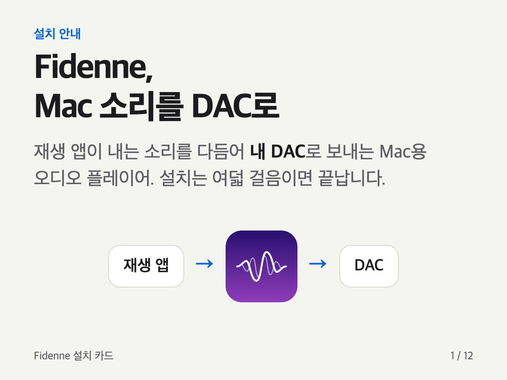

Fidenne은 음악 앱이 내는 소리를 다듬어 내 DAC로 보낸다. 그림 가운데의 흐름처럼 **재생 앱 → Fidenne → DAC** 순서다.
음악은 Apple Music · Spotify · YouTube Music 앱(또는 브라우저)에서 평소처럼 고르고 틀면 되고, Fidenne은 그 사이에서 소리를 받아 처리해 DAC로 넘긴다.
Fidenne이 소리를 저장하거나 파일로 만들지는 않는다.

그림에는 설치가 여덟 걸음이면 끝난다고 적혀 있다. 이 글에서는 그 걸음(준비 · 내려받기 · 옮기기 · 처음 열기 · 처음 설정 · 권한 · 음량 · 막혔을 때)을 설치 2 부터 9 까지 하나씩 풀고,
뒤에 고르는 연결 셋(Spotify 둘, YouTube Music 하나)을 이어 붙였다. 위 그림 한 장만 보고 순서대로 따라 해도 된다.

자세히: [사용 설명서 — 한눈에](MANUAL.md#0-한눈에)

## 설치 2 · 준비물

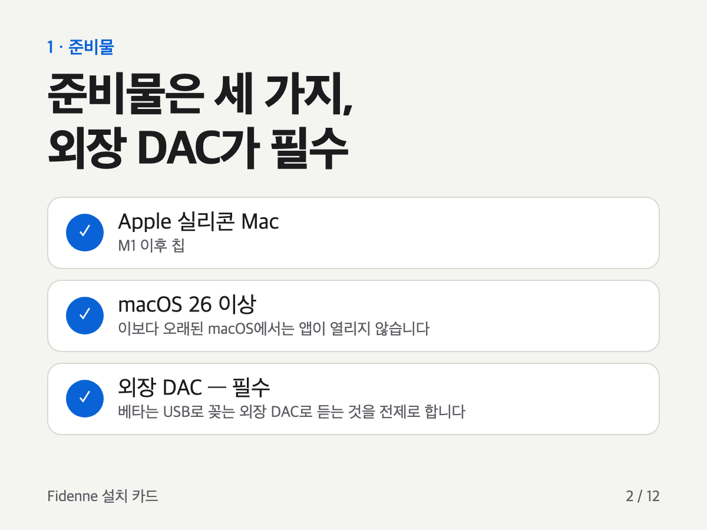

Fidenne은 **Apple 실리콘 Mac**(M1 이후 칩)에서 **macOS 26 이상**일 때만 열린다. 내 Mac이 어떤 칩인지는 화면 맨 위 메뉴 막대의 Apple 로고 › **이 Mac에 관하여** 에서 볼 수 있다.
칩 이름이 "Apple M" 으로 시작하면 된다. macOS가 26 보다 낮으면 앱이 열리지 않으므로, 먼저 시스템 설정에서 소프트웨어 업데이트를 한다.

**유선 USB 외장 DAC는 필수다.** 베타는 외장 DAC로 듣는 것을 전제로 만들었다. 소리를 다듬는 기능(EQ 같은 것)은 352.8 kHz 이상을 받는 2채널 외장 DAC에서만 돈다.
내장 스피커나 AirPods는 이 기능을 쓸 수 없고 소리를 그대로 듣는 PCM Direct로만 나오므로, 이 베타의 대상이 아니다.

자세히: [사용 설명서 — 한눈에](MANUAL.md#0-한눈에) · [알려진 한계](KNOWN_LIMITATIONS.md)

## 설치 3 · 내려받기

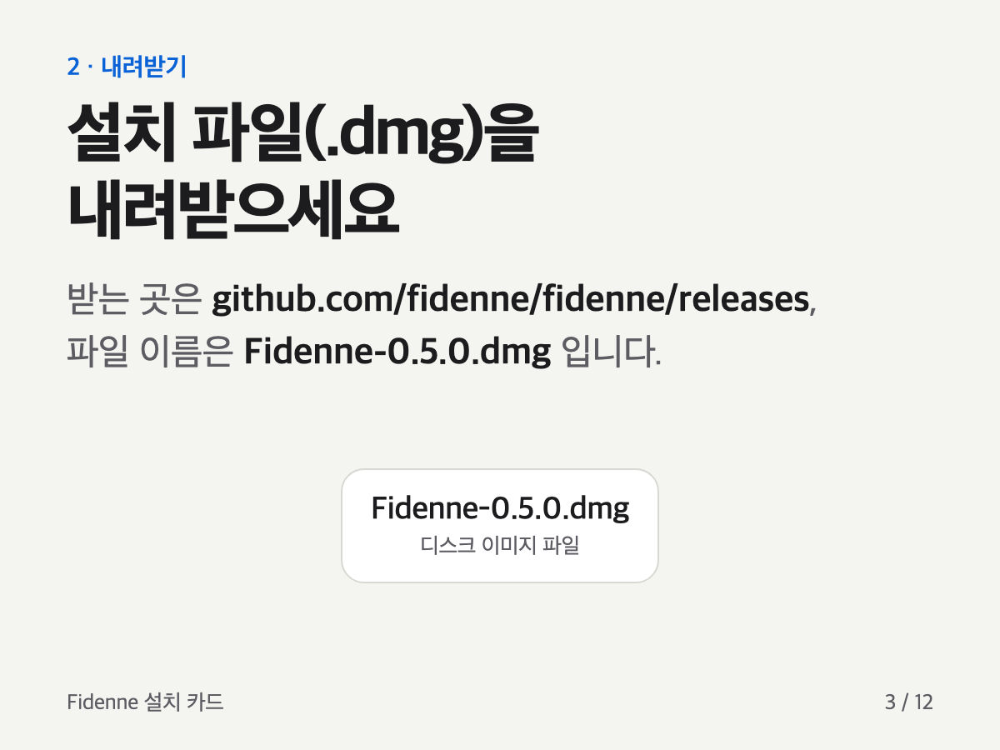

설치 파일은 Fidenne 공개 페이지(GitHub)의 **릴리스** 항목에서 받는다: `github.com/fidenne/fidenne/releases`(지금은 최종 검수 중이라 아직 올라와 있지 않다). 가장 위에 있는 최신 항목을 열고 `.dmg` 로 끝나는 파일을 누른다.
`.dmg`는 Mac에서 앱을 담아 배포하는 디스크 이미지 파일이다. 받은 파일은 보통 **다운로드** 폴더에 들어간다.

받는 데 시간이 걸리면 끝날 때까지 기다린다. 파일이 열리지 않거나 이름이 다르면 최신 항목이 맞는지 다시 확인한다.
앱은 서명과 공증을 거쳐 배포된다. 다른 곳에서 받은 파일은 쓰지 않는다.

자세히: [할 일별 지시서 — 베타를 받고 문제를 알리기](HOW-TO.md#30-베타를-받고-문제를-알리기)

## 설치 4 · 옮기기

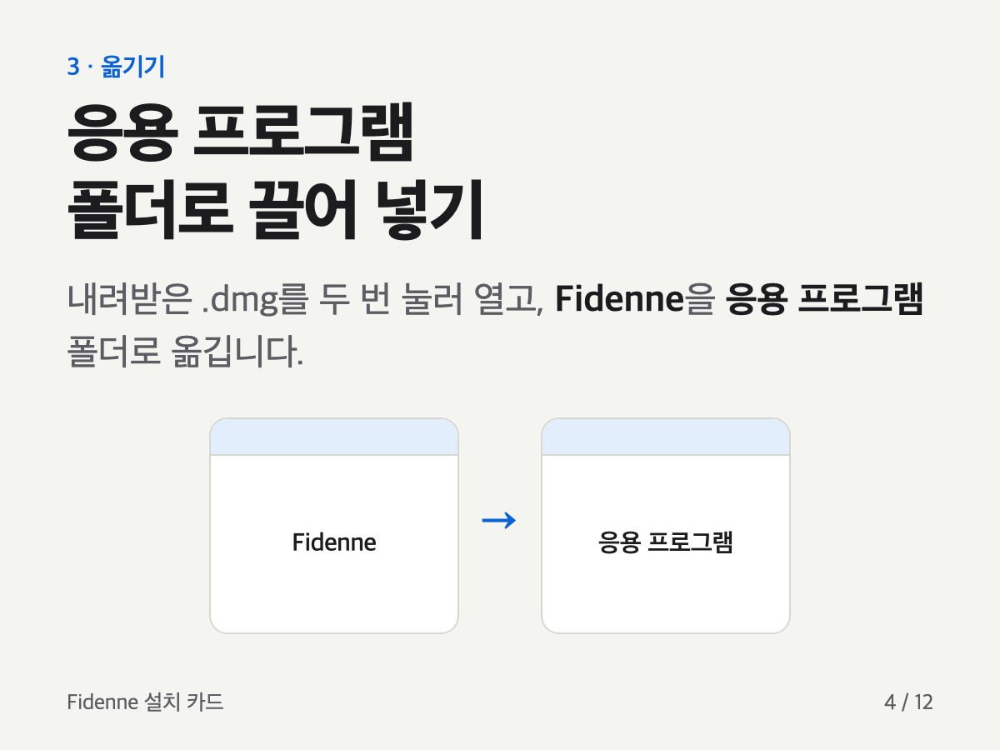

받은 `.dmg`를 두 번 누르면 작은 창이 열린다. 창 안의 **Fidenne** 아이콘을 **응용 프로그램** 폴더 쪽으로 끌어다 놓는다.
복사가 끝나면 창을 닫고, 열린 디스크 이미지는 Finder 사이드바에서 꺼내기(⏏) 단추로 닫아도 된다.

앱을 응용 프로그램 폴더에 두어야 나중에 업데이트하기 좋다. 이미 같은 이름의 앱이 있다는 창이 뜨면 새것으로 바꾸는 쪽을 고른다.

## 설치 5 · 처음 열기

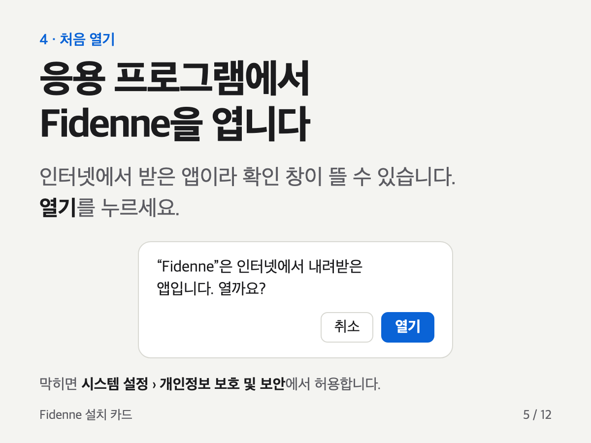

응용 프로그램 폴더에서 Fidenne을 연다. 인터넷에서 받은 앱은 macOS가 한 번 "열까요?" 하고 묻는다. **열기** 를 누르면 된다.

그래도 열리지 않으면 시스템 설정 › 개인정보 보호 및 보안 에서 Fidenne을 허용하는 길이 있다. 이 창의 정확한 문구는 macOS 판마다 조금 다를 수 있다.
그림의 이 장면은 공증을 마친 실제 배포판 화면으로 다시 확인해야 하는 부분이다.
Mac이 macOS 26 보다 낮으면 앱이 아예 열리지 않는다. 이때는 설치 2 로 돌아가 macOS를 올린다.

자세히: [문제 확인 가이드 — 그 밖의 증상](TROUBLESHOOTING.md#8-그-밖의-증상)

## 설치 6 · 처음 설정

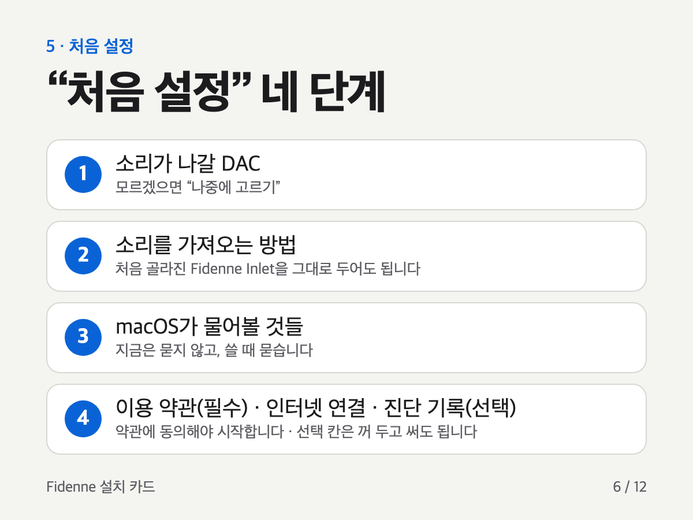

처음 열면 "Fidenne 처음 설정" 창이 뜨고 네 단계를 거친다. 단계마다 **뒤로 / 다음** 으로 오간다.

1. **소리가 나갈 DAC**: 내 DAC를 고른다. 모르겠으면 **나중에 고르기** 를 눌러도 된다. DAC가 안 보이면 꽂은 뒤 새로고침한다.
2. **소리를 가져오는 방법**: 처음부터 **Fidenne Inlet** 이 골라져 있다. 음악 앱이 내는 소리를 원래 상태 그대로 받아 오는 가상 장치다. 그대로 두면 된다.
   설치가 안 되어 있으면 **설치…** 를 누른다. Mac의 관리자 암호를 한 번 묻고, 설치하는 순간 잠깐 모든 소리가 끊긴다.
3. **macOS가 물어볼 것들**: 지금은 묻지 않고, 그 기능을 처음 쓸 때 묻는다.
4. **이용 약관 · 인터넷 연결 · 진단 기록**: 약관 아래 확인 칸이 넷 있다(**전체 동의** · **[필수] 이용 약관** · **[선택] 인터넷 연결 기능 사용** · **[선택] 문제 제보용 진단 기록**). 선택 칸은 꺼져 있고, 필수 칸을 눌러야 **시작** 을 누를 수 있다. 동의하지 않고 종료를 누르면 앱이 꺼진다. 선택 칸을 켜지 않아도 재생은 된다.

네 단계를 마치면 같은 창에 사이드바(페이지 목록)와 페이지가 나타난다. 다음 실행부터는 이 창이 다시 뜨지 않는다.
어느 쪽을 골라도 모든 기능을 쓸 수 있고, 나중에 설정에서 바꿀 수 있다.

자세히: [사용 설명서 — 처음 켤 때](MANUAL.md#1-처음-켤-때--처음-설정-네-단계)

## 설치 7 · 권한

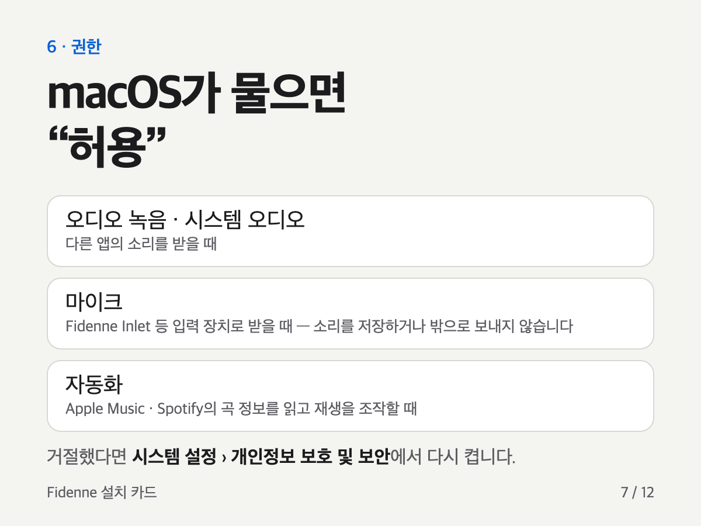

권한은 macOS가 그 기능을 처음 쓰는 순간에 묻는다. 세 가지가 나올 수 있다.

- **오디오 녹음 · 시스템 오디오**: 다른 앱이 내는 소리를 받을 때. "녹음" 이라는 말이 붙어 있지만 Fidenne은 소리를 저장하지 않는다.
- **마이크**: Fidenne Inlet 같은 입력 장치로 소리를 받을 때. 이것도 소리를 저장하거나 밖으로 보내지 않는다.
- **자동화**: Apple Music이나 Spotify의 지금 곡 정보를 읽고, 재생 · 일시정지를 전할 때.

묻는 창이 뜨면 **허용** 을 누른다. 실수로 거절했다면 시스템 설정 › 개인정보 보호 및 보안 에서 해당 항목의 Fidenne을 다시 켠다.
허용하지 않은 채로 쓰면 소리가 안 들어오거나 곡 정보가 안 보일 수 있다.

자세히: [사용 설명서 — 처음 켤 때](MANUAL.md#1-처음-켤-때--처음-설정-네-단계) · [문제 확인 가이드 — 소리가 안 난다](TROUBLESHOOTING.md#1-소리가-안-난다)

## 설치 8 · 첫 재생 전에 음량을 낮추기

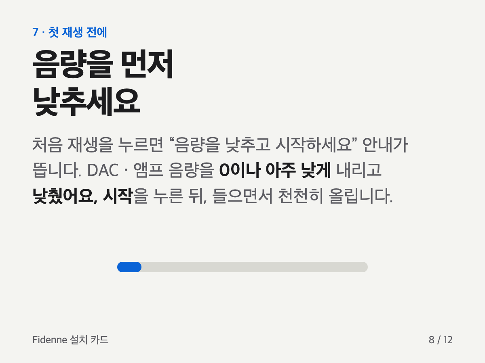

앱을 켜고 처음 재생을 누르면 소리가 나기 전에 "음량을 낮추고 시작하세요" 창이 뜬다. DAC나 앰프의 음량을 **0이나 아주 낮게** 내린다.
그다음 **낮췄어요, 시작** 을 누르고, 소리를 들으면서 천천히 올린다. **취소** 를 누르면 아무것도 시작하지 않는다.

이 안내는 앱을 켤 때마다 처음 재생에서 한 번 뜬다. 이 앱으로 처음 쓰는 DAC에서도 한 번 더 뜬다. 처음 보내는 소리가 갑자기 클 수 있어서 귀와 장비를 지키려는 것이다.
재생을 눌렀는데 아무 일도 없다면 이 창이 다른 창 뒤에 있는지 본다.

자세히: [할 일별 지시서 — 음량 안내 켜고 끄기](HOW-TO.md#24-소리-내기-전-음량-안내--출력-감시-켜고-끄기)

## 설치 9 · 막혔을 때

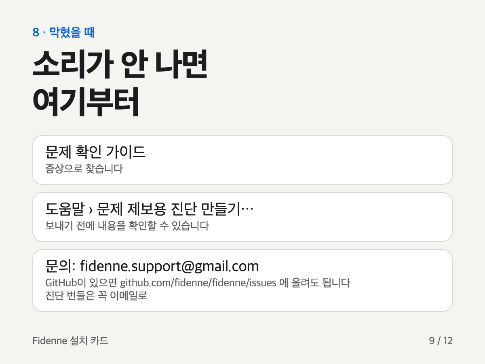

소리가 안 나거나 이상하면 먼저 [문제 확인 가이드](TROUBLESHOOTING.md)에서 증상으로 찾는다. 가장 흔한 "소리가 안 난다" 는 그 첫 항목이다.

해결이 안 되면 앱의 진단 메뉴 › **지원용 진단 내보내기…** 로 지원 파일을 만든다. 보내기 전에 파일에 무엇이 들었는지 화면에 보여 준다.
앱은 아무것도 대신 보내지 않으므로, 보낼지 말지는 내가 정한다. 문의는 **fidenne.support@gmail.com** 으로 메일을 보낸다.
GitHub 계정이 있으면 `github.com/fidenne/fidenne/issues` 에 글을 써도 되지만, 진단 파일은 **꼭 메일로만** 보낸다. 이슈에는 올리지 않는다.

자세히: [사용 설명서 — 지원 파일 보내기](MANUAL.md#10-지원-파일-보내기) · [문제 확인 가이드 — 그래도 안 되면](TROUBLESHOOTING.md#9-그래도-안-되면--무엇을-모아-보내나)

## 설치 10 · (선택) Spotify 연결 ① 내 앱 만들기

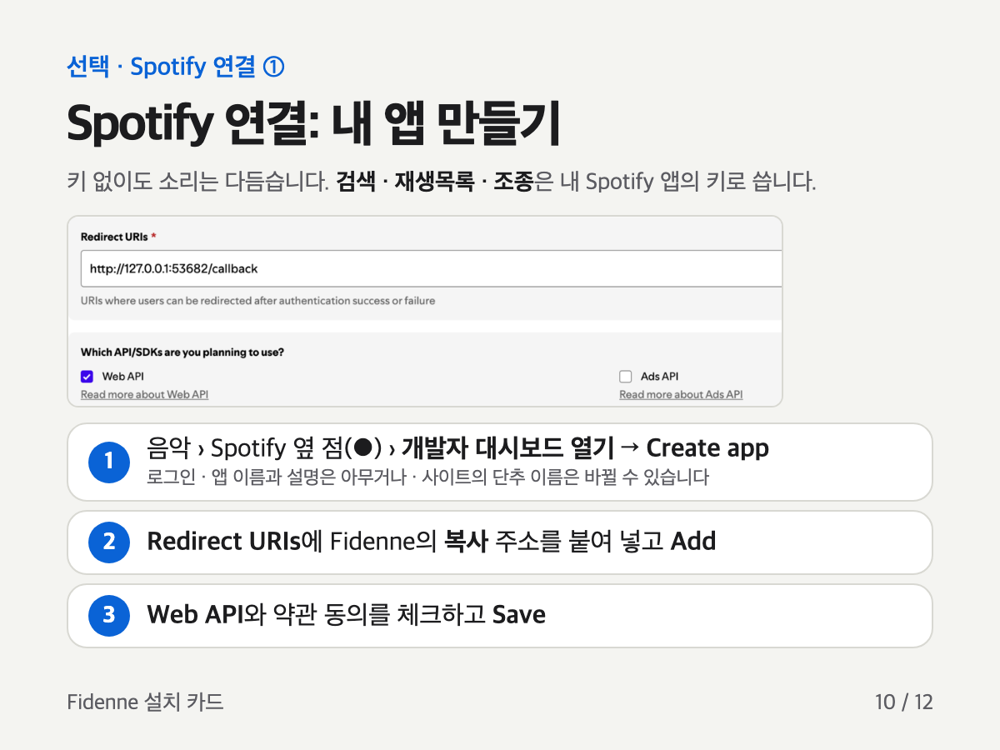

이 부분은 **하지 않아도 된다.** Spotify 앱에서 곡을 고르면 키 없이도 Fidenne이 소리를 다듬고, 지금 재생 중인 곡도 보여 준다.
Fidenne 안에서 Spotify 검색 · 재생목록 · 재생 조종을 쓰고 싶을 때만 필요하다. Fidenne 에는 Spotify 키가 들어 있지 않아서 내 Spotify 개발자 앱의 키를 쓴다.

1. Fidenne의 음악 페이지에서 Spotify 옆 점 › **개발자 대시보드 열기** 를 눌러 브라우저에서 Spotify 로그인 후 **Create app** 을 누른다. 앱 이름과 설명은 아무거나 적는다. 사이트의 단추 이름은 바뀔 수 있다.
2. **Redirect URIs** 칸에 Fidenne에 보이는 주소를 붙여 넣는다. 그 옆 **복사** 단추가 주소를 복사해 준다. 그다음 **Add**.
3. **Web API** 와 약관 동의를 체크하고 **Save**.

여기서 동의하는 것은 Spotify 개발자 약관이다. 내가 직접 동의하는 것이고, 이 약관은 Spotify가 정한다.

자세히: [할 일별 지시서 — Spotify를 처음 연결하기](HOW-TO.md#29-spotify-를-처음-연결하기내-키) · [사용 설명서 — 음악 페이지](MANUAL.md#3-음악-페이지)

## 설치 11 · (선택) Spotify 연결 ② 키 넣기

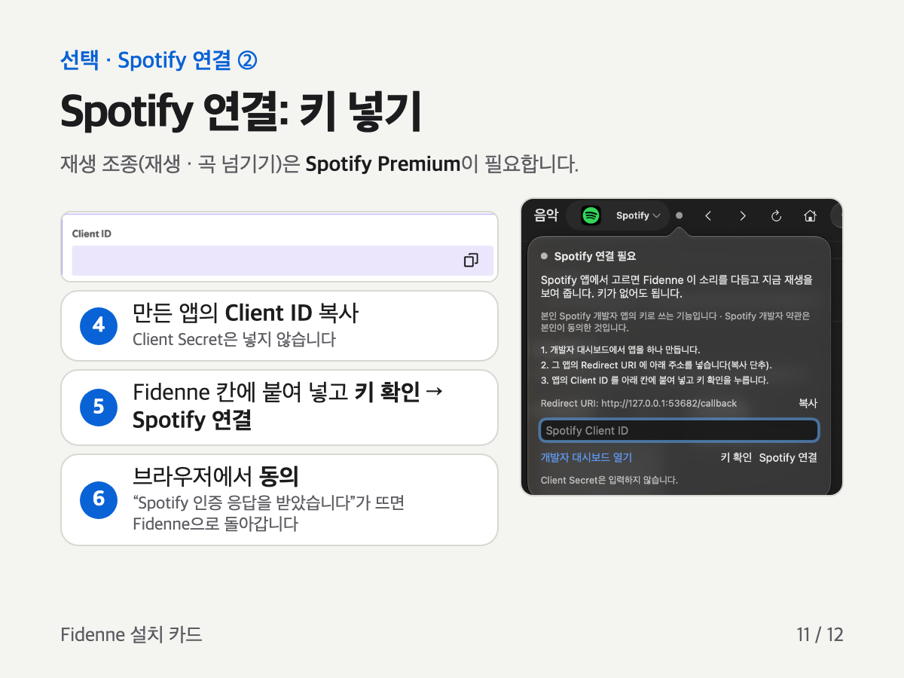

만든 앱의 **Client ID** 를 복사해 Fidenne의 칸에 붙여 넣는다. **Client Secret 은 넣지 않는다.** 대시보드 주소를 통째로 붙여 넣어도 그 안의 ID 를 읽는다.
**키 확인** 을 누르면 형식이 맞는지 바로 알려 준다. 맞으면 **Spotify 연결** 을 누르고, 브라우저에서 **동의** 를 누른다.
"Spotify 인증 응답을 받았습니다" 가 뜨면 Fidenne으로 돌아온다.

Spotify에서 곡을 재생 · 일시정지 · 넘기는 조종은 **Spotify Premium** 이 있어야 한다. 키 확인에서 글자 수나 쓸 수 없는 글자를 지적하면 복사할 때 앞뒤 공백이 섞였는지 본다.
요청이 너무 많으면 Spotify가 잠시 쉬라고 한다. 이때 연결은 그대로이고, 안내된 시간이 지난 뒤 다시 하면 된다.
연결한 뒤에는 설정에 **재생 권한 갱신** 과 **연결 해제** 가 생긴다.

자세히: [할 일별 지시서 — Spotify를 처음 연결하기](HOW-TO.md#29-spotify-를-처음-연결하기내-키)

## 설치 12 · (선택) YouTube Music

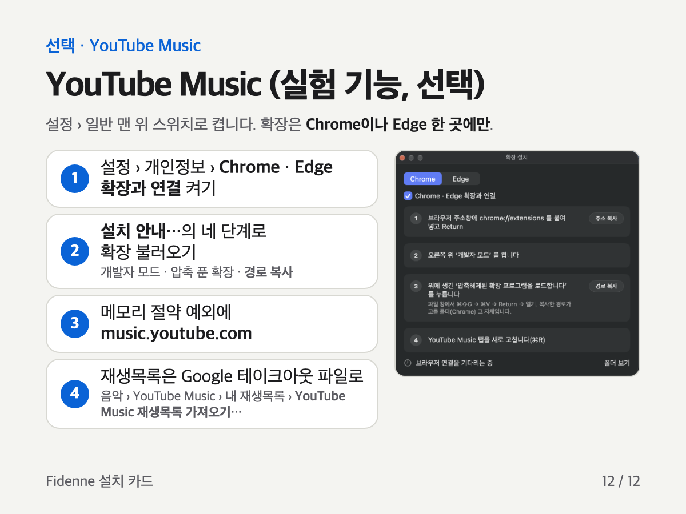

YouTubeMusic은 **실험 기능** 이라 처음에는 꺼져 있다. 새로 설치하면 꺼진 채로 시작하고, **설정 › 일반** 맨 위 스위치로 켠다.
YouTubeMusic은 Mac 앱이 없어서 **Chrome 이나 Edge** 에서 듣고, Fidenne은 확장(브라우저에 더하는 작은 프로그램)으로 곡 정보를 받고 재생을 조작한다. 소리는 평소처럼 Fidenne Inlet이 받는다. 확장은 **한 브라우저에만** 설치한다. Safari 는 지원하지 않는다.

1. **설정 › 개인정보 › Chrome · Edge 확장과 연결** 을 켠다.
2. 같은 곳의 **설치 안내…** 를 누르면 네 단계 창이 뜬다. 브라우저에서 확장 페이지 열기, 개발자 모드 켜기, 압축을 푼 확장 불러오기(안내 창의 **경로 복사** 를 눌러 붙여 넣는다), 열려 있는 YouTube Music 탭 새로 고침(⌘R) 순서다.
3. 브라우저가 쓰지 않는 탭을 재워 두면 YouTube Music 이 응답하지 못한다. Chrome 은 설정 → 성능 → 메모리 절약 → **항상 활성 상태를 유지할 사이트**, Edge 는 설정 → 시스템 및 성능 → 리소스 절약 → **이 사이트를 절전 모드로 전환하지 않음** 에 `music.youtube.com` 을 더한다.
4. 재생목록은 두 길로 가져온다. 확장이 연결된 채로 YouTubeMusic에서 재생목록 화면을 열면 저절로 담긴다. 또는 Google 테이크아웃(내 데이터 내려받기) 파일을 가져온다. 담긴 목록은 **음악 › YouTube Music › 내 재생목록** 에 모인다.

안내 창 맨 아래 줄이 **브라우저 1개 연결됨** 으로 바뀌면 연결된 것이다. 아직 웹 스토어에는 없어서 개발자 모드로만 설치한다. 앱을 업데이트한 뒤에는 확장 페이지에서 Fidenne 확장의 새로 고침(↻)을 한 번 누른다.
YouTube Music 화면이 바뀌면 동작이 멈출 수 있다. 실험 기능이라는 말은 그런 뜻이다.

자세히: [사용 설명서 — YouTube Music 쓰기](MANUAL.md#81-youtube-music-쓰기-chrome-확장) · [할 일별 지시서 — YouTube Music 조작하기](HOW-TO.md#25-youtube-musicchrome을-fidenne-에서-보고-조작하기) · [사용 설명서 — 재생목록 가져오기](MANUAL.md#41-youtube-music-재생목록-가져오기)

---

# 2부. 쓰기

## 쓰기 1 · 시작

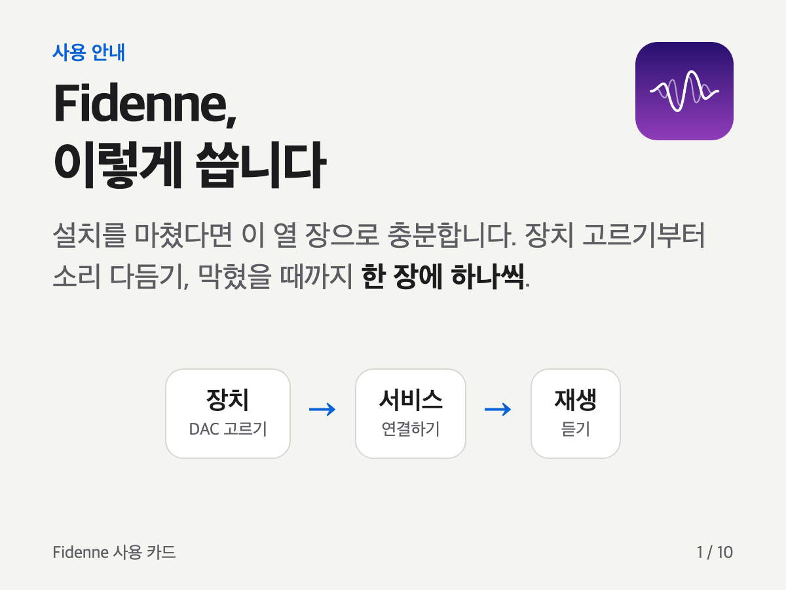

설치를 마쳤다면 이 열 장으로 충분하다. 장치 고르기 → 서비스 연결하기 → 재생하기, 그림 가운데의 세 단계를 따라간다. 한 장에 하나씩 나온다.
이 안내는 한국어 화면 기준이다. 그림 속 단축키(⌘1, ⌘4, ⌘5 처럼 ⌘ 는 키보드의 Command 키)는 사이드바 페이지를 바로 여는 키다.

자세히: [사용 설명서](MANUAL.md) · [할 일별 지시서](HOW-TO.md)

## 쓰기 2 · 소리가 나갈 DAC 고르기

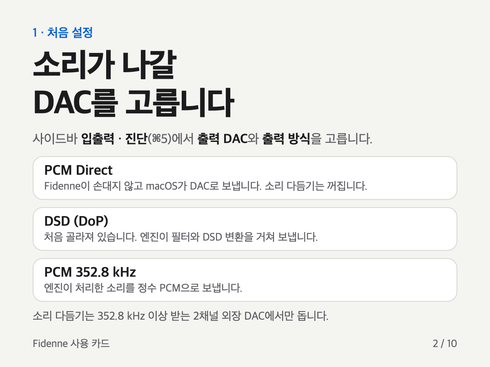

사이드바의 **입출력 · 진단**(⌘5)을 열어 **출력 DAC** 와 **출력 방식** 을 고른다. DAC가 안 보이면 꽂은 뒤 새로고침(↻)을 누른다. 출력 방식은 셋이다.

- **PCM Direct**: Fidenne이 소리에 손대지 않고 macOS가 DAC로 보낸다. 소리를 다듬는 기능은 꺼진다. 가장 단순하고, 어떤 장치에서도 된다.
- **DSD (DoP)**: 처음에 골라져 있다. Fidenne 엔진이 필터와 DSD 변환을 거쳐 보낸다. DSD를 받는 DAC 여야 한다.
- **PCM 352.8 kHz**: 엔진이 처리한 소리를 정수 PCM으로 보낸다. DSD를 모르는 DAC에 맞다.

소리 다듬기는 352.8 kHz 이상을 받는 2채널 외장 DAC에서만 돈다. 그렇지 않은 장치는 목록에서 이름 끝에 `· PCM Direct 만` 이 붙는다.
DSD로 시작했는데 쉬익 · 치직 하는 큰 잡음이 나면 곧바로 멈추고 PCM 352.8 kHz 로 바꾼다. 그 DAC는 DSD(DoP)를 풀지 못하는 것이다.
이 앱으로 처음 쓰는 DAC에서 DSD를 처음 보낼 때는 한 번 확인 창이 뜬다.

자세히: [사용 설명서 — 출력 방식](MANUAL.md#71-출력-독립-제어--출력-방식) · [할 일별 지시서 — 출력 장치 바꾸기](HOW-TO.md#4-출력-장치dac-바꾸기) · [출력 형식 바꾸기](HOW-TO.md#5-출력-형식-바꾸기--dsd--pcm-정수--pcm-direct)

## 쓰기 3 · 음량부터 낮추기

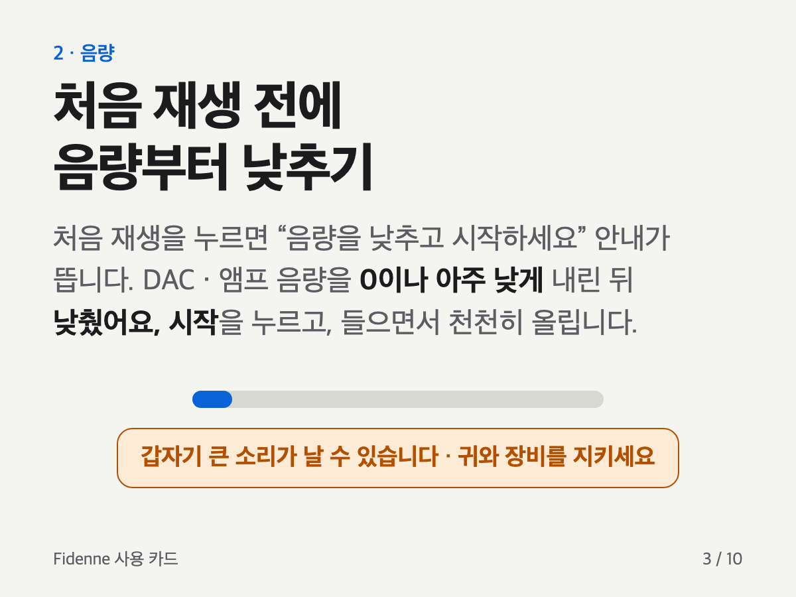

앱을 켠 뒤 처음 재생을 누르면 "음량을 낮추고 시작하세요" 창이 뜬다. DAC와 앰프의 음량을 0이나 아주 낮게 내린 다음 **낮췄어요, 시작** 을 누르고, 들으면서 천천히 올린다.
**취소** 를 누르면 아무것도 시작하지 않는다.

이 창은 설정 › **소리 안전** 에서 끌 수 있다. 꺼 두어도 이 앱으로 처음 쓰는 DAC 에서는 한 번 묻는다.
PCMDirect로 바꿀 때도 주의한다. 엔진의 안전한 여유 음량이 적용되지 않으므로 바꾸기 전에 DAC 음량을 확인한다.

자세히: [할 일별 지시서 — 음량 안내](HOW-TO.md#24-소리-내기-전-음량-안내--출력-감시-켜고-끄기) · [사용 설명서 — 처음 켤 때](MANUAL.md#1-처음-켤-때--처음-설정-네-단계)

## 쓰기 4 · 서비스 연결

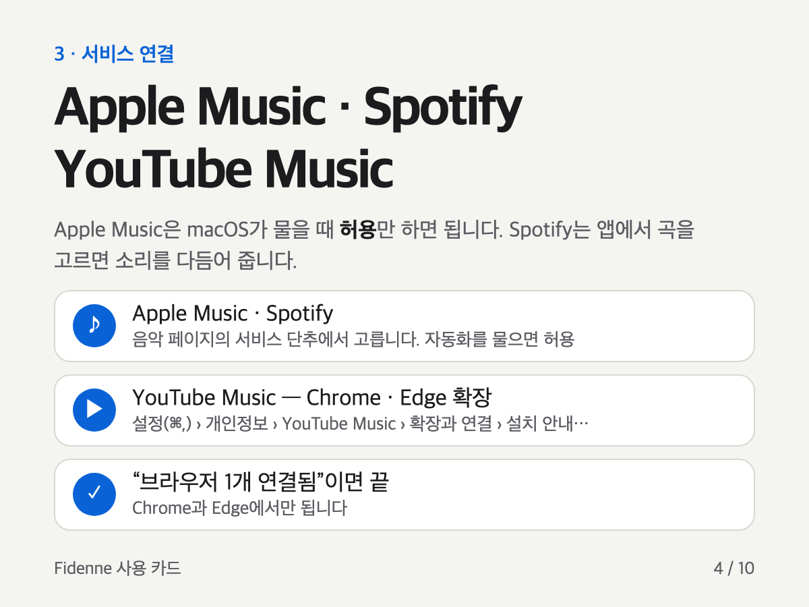

**Apple Music** 은 macOS가 허용을 물을 때 **허용** 만 하면 된다. **Spotify** 는 Spotify 앱에서 곡을 고르면 Fidenne이 소리를 다듬는다. 두 서비스는 음악 페이지 검색 칸 앞의 서비스 단추로 고른다.

**YouTube Music** 은 설정(⌘,) › 개인정보 › YouTube Music › 확장과 연결 › **설치 안내…** 를 따라 한다(설치 12 참고). 안내 창에 **브라우저 1개 연결됨** 이 뜨면 끝이다. Chrome 과 Edge 에서만 된다.

엔진 스위치(하단 막대의 상태 점 옆)를 켜면 음악 앱이 내는 소리가 Fidenne을 거친다. **자동 감지** 로 두면 스위치가 곡을 틀지 않으므로, 음악 앱에서 곡을 직접 튼다.
소리가 Fidenne을 거치는데도 안 들리면 입출력 페이지의 입력과 출력이 내가 고른 것인지 확인한다.
Fidenne 에는 서비스 구독을 대신하는 기능이 없다. 곡은 늘 각 서비스의 앱에서 내 계정으로 재생된다.

자세히: [할 일별 지시서 — Apple Music · Spotify를 Fidenne으로 듣기](HOW-TO.md#1-apple-music--spotify-를-fidenne-으로-듣기) · [사용 설명서 — YouTube Music 쓰기](MANUAL.md#81-youtube-music-쓰기-chrome-확장)

## 쓰기 5 · 하단 재생 캡슐

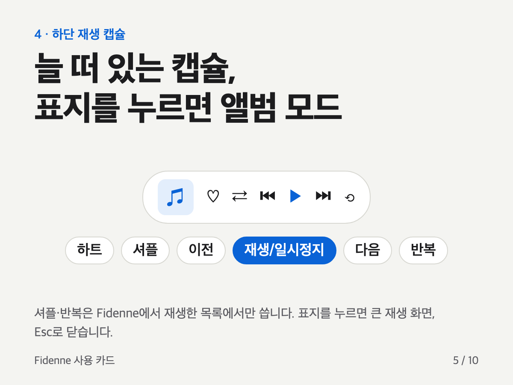

창 아래에 늘 떠 있는 막대를 재생 캡슐이라 부른다. 하트 · 셔플 · 이전 · 재생/일시정지 · 다음 · 반복과 재생 위치가 있다.
**셔플과 반복은 Fidenne에서 재생한 목록에서만** 쓸 수 있다. 음악 앱이 따로 관리하는 대기열은 그 앱에서 다룬다.

앨범 표지를 누르면 큰 재생 화면(앨범 모드)이 열린다. **Esc** 키나 닫기(×) 단추, 표지를 다시 누르는 것으로 닫는다.
막대 끝의 스위치는 엔진을 켜고 끄는 것이다. 일시정지는 음악 앱만 멈추고 엔진은 켜 둔다. 엔진이 꺼져 있을 때 재생을 누르면 엔진을 켜고 곡을 튼다.
막대의 ⋯ 를 누르면 곡 메뉴와 출력 설정이 있다. 막대가 안 보이면 창을 넓힌다.

자세히: [사용 설명서 — 하단 재생 막대](MANUAL.md#22-하단-재생-막대)

## 쓰기 6 · 음악 페이지

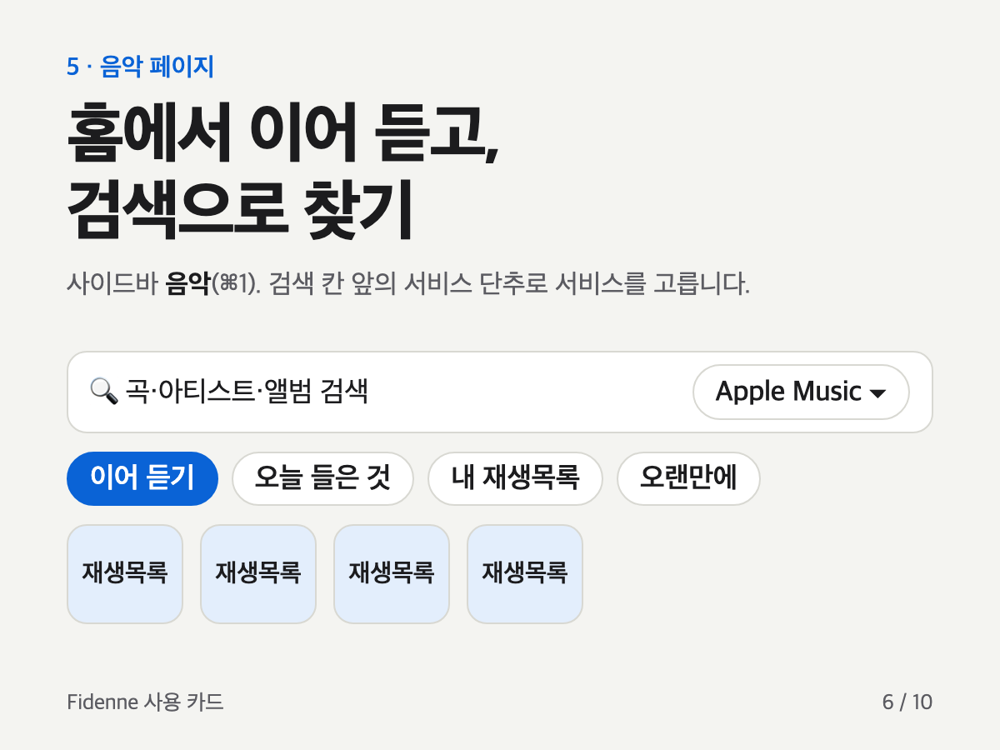

사이드바의 **음악**(⌘1)을 연다. 검색 칸 앞의 서비스 단추를 눌러 Apple Music · Spotify · YouTube Music 중 하나를 고르고, 곡 · 아티스트 · 앨범을 검색한다.
홈에는 **이어 듣기** · **오늘 들은 것** · **내 재생목록** · **오랜만에** 가 보인다.

Spotify 검색 결과는 다른 서비스와 섞이지 않고, 결과 맨 위 **Spotify** 탭을 눌러야 따로 보인다. 서비스 약관 때문이다. 곡을 누르면 지금 재생이나 다음에 재생을 고를 수 있다.
Spotify 검색이 안 되면 키를 넣었는지 본다(설치 10 · 11). YouTubeMusic이 "연결 안 됨" 이면 설치 12 를 따라 한다.

자세히: [사용 설명서 — 음악 페이지](MANUAL.md#3-음악-페이지)

## 쓰기 7 · Fidenne 보관함

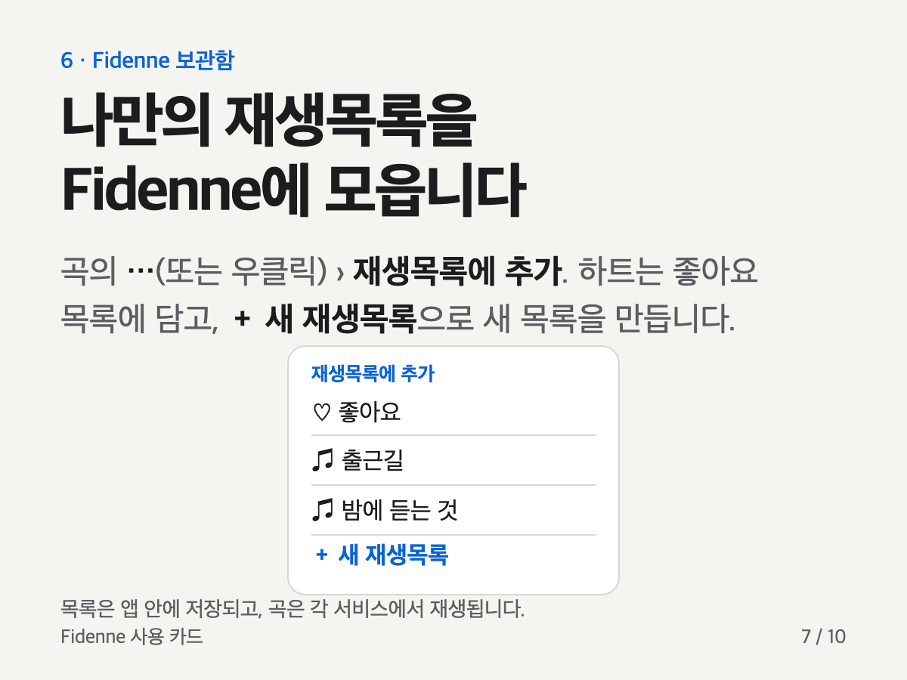

곡 줄 끝의 **⋯**(또는 우클릭)를 누르고 **재생목록에 추가** 를 고른다. 하트는 좋아요 목록에 담는다. **＋ 새 재생목록** 으로 이름을 정해 새 목록을 만든다.

목록은 Fidenne 안에 저장되고, 곡은 각 서비스에서 재생된다. 그래서 서비스에서 곡이 사라지면 목록의 그 줄은 재생되지 않을 수 있다.
이 Mac의 음악 파일은 사이드바의 **보관함** 페이지에서 폴더를 추가하면 모인다. WAV · AIFF · FLAC · ALAC · AAC · MP3 · Opus 를 읽고, 파일 자체는 옮기거나 바꾸지 않는다.
목록을 지워도 곡 파일은 그대로 남는다.

자세히: [사용 설명서 — 곡 메뉴](MANUAL.md#27-곡-메뉴---와-우클릭) · [보관함 페이지](MANUAL.md#4-보관함-페이지)

## 쓰기 8 · 다음 재생과 가사 패널

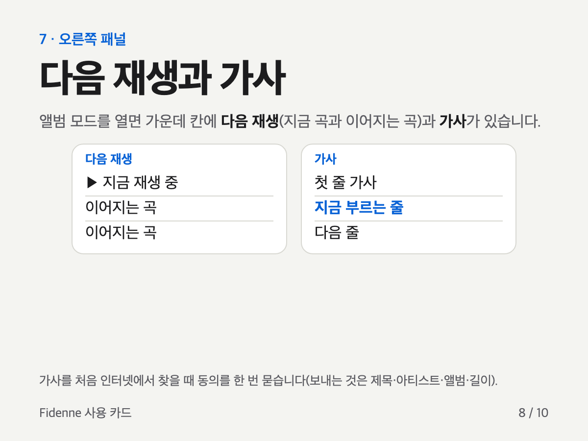

앨범 모드를 열면 가운데 칸에 **다음 재생**(지금 곡과 이어지는 곡)과 **가사** 가 있다. 가사는 지금 부르는 줄이 또렷하게 보이고 멀어질수록 옅어진다.
가사 파일(LRC 또는 TXT)을 곡에 직접 연결할 수도 있고, 가사가 음악보다 빠르거나 늦으면 타이밍을 조금씩 고칠 수 있다.

가사를 처음 인터넷에서 찾을 때는 동의를 한 번 묻는다. 보내는 것은 **곡 제목 · 아티스트 · 앨범 · 길이** 뿐이고, 소리와 계정 정보는 보내지 않는다. 동의하지 않으면 보내지 않는다.
가사가 안 나오면 새로고침(↻)을 누른다. 못 찾은 곡은 30분 동안 다시 묻지 않는다.

자세히: [사용 설명서 — 가사](MANUAL.md#23-가사) · [할 일별 지시서 — 가사 보기](HOW-TO.md#17-가사-보기)

## 쓰기 9 · 소리 다듬기

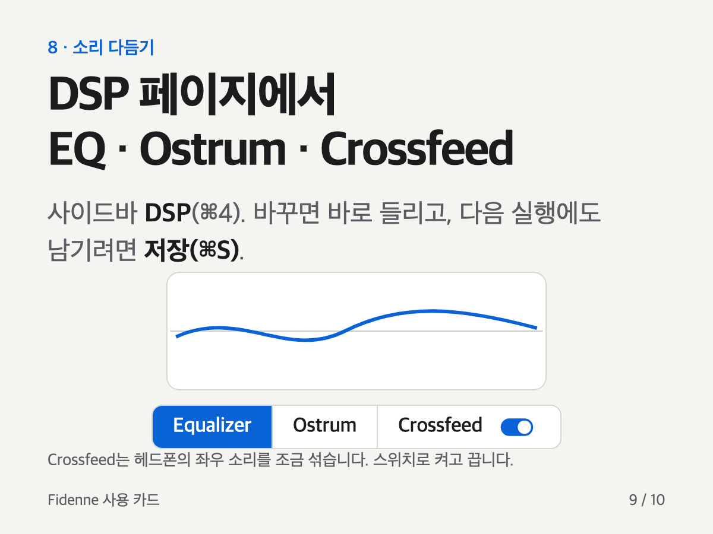

사이드바의 **DSP**(⌘4)를 연다. 위쪽 그래프 밑에 **Equalizer · Ostrum · Crossfeed** 세 탭이 있다.

- **Equalizer**: 높은 소리와 낮은 소리의 크기를 구간별로 조절한다.
- **Ostrum**: 저음 · 존재감 · 소리의 폭을 다듬는 Fidenne 만의 기능이다.
- **Crossfeed**: 헤드폰의 좌우 소리를 조금 섞는다. 스위치로 켜고 끈다.

값을 바꾸면 **바로 들린다.** 다음 실행에도 남기려면 **저장**(⌘S)을 누른다. 저장하지 않으면 앱을 껐다 켰을 때 돌아간다.
DSP는 엔진을 거칠 때만 작동하므로, PCMDirect로 두었거나 352.8 kHz 를 받지 않는 장치에서는 소리가 안 바뀐다. 이때는 쓰기 2 로 간다.
소리가 너무 커지면 EQ 를 크게 올린 것이 이유일 수 있으니 먼저 줄여 본다.

자세히: [사용 설명서 — DSP 페이지](MANUAL.md#6-dsp-페이지) · [할 일별 지시서 — EQ](HOW-TO.md#9-eq-를-손으로-만들고-적용--저장) · [Crossfeed](HOW-TO.md#12-헤드폰의-좌우-분리를-줄이기--크로스피드)

## 쓰기 10 · 막혔을 때

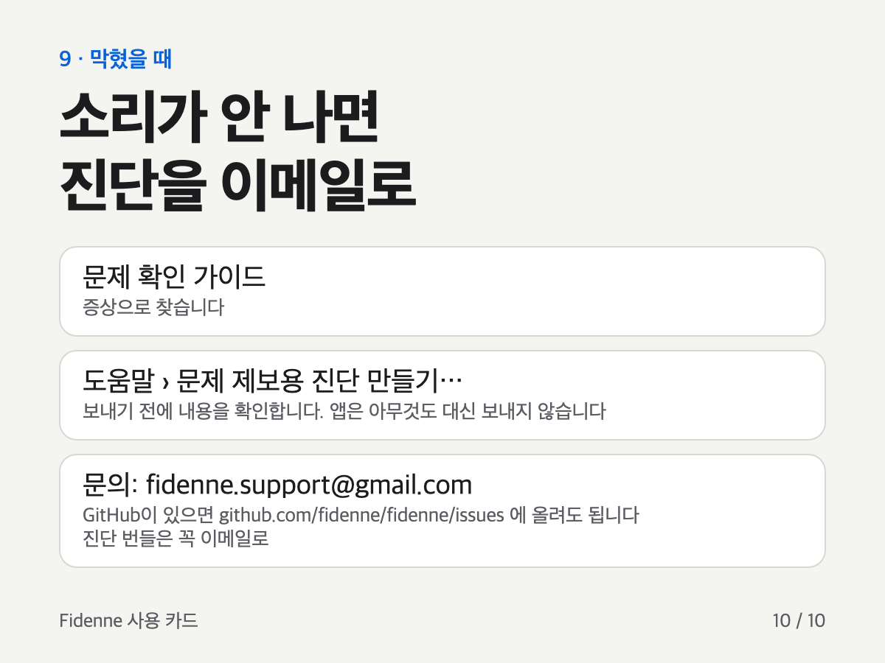

소리가 안 나면 [문제 확인 가이드](TROUBLESHOOTING.md)에서 증상으로 찾는다. 먼저 볼 것은 세 가지다. 하단 막대의 엔진 상태가 **실행 중** 인지,
DAC와 앰프의 음량이 올라 있는지, 음량 안내 창이 떠 있지 않은지.

그래도 안 되면 메뉴 **도움말 › 문제 제보용 진단 만들기…** 를 연다. 진단 기록을 시작하고 문제를 한 번 일으킨 뒤 번들을 만들면, 보내기 전에 내용을 보여 준다.
**메일로 보내기** 가 메일 앱에 주소와 제목을 채워 열어 준다. 번들은 직접 붙인다. 앱은 아무것도 대신 보내지 않는다.

문의는 **fidenne.support@gmail.com**. 메일에는 앱 버전 · macOS 버전 · DAC와 출력 방식 · 언제 무엇을 하다가 무엇이 들렸는지를 함께 적는다.
번들에는 그 시간대에 들은 곡의 제목과 아티스트가 들어 있다. 진단 번들은 **메일로만** 보내고 GitHub 이슈에는 올리지 않는다.

자세히: [문제 확인 가이드](TROUBLESHOOTING.md#9-그래도-안-되면--무엇을-모아-보내나) · [할 일별 지시서 — 베타를 받고 문제를 알리기](HOW-TO.md#30-베타를-받고-문제를-알리기)
